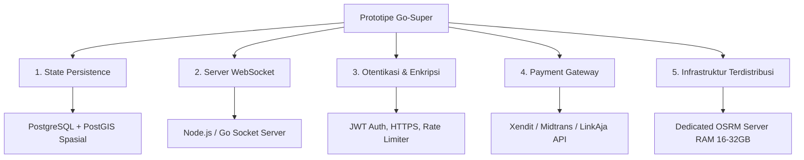

# DOKUMEN ANALISIS KOMPARATIF: EKOSISTEM GO-SUPER VS GOJEK, GRAB, DAN SHOPEE

Dokumen ini disusun sebagai panduan teknis dan operasional untuk menganalisis pemetaan fitur, perbedaan arsitektur dasar, serta langkah-langkah transisi sistem dari prototipe simulasi **Go-Super** menuju arsitektur produksi berskala industri (*production-ready*) seperti yang diterapkan oleh **Gojek**, **Grab**, dan **Shopee**.

---

## DAFTAR ISI
1. [Pendahuluan & Konsep Utama](#1-pendahuluan--konsep-utama)
2. [Tabel Pemetaan Fitur (Feature Mapping)](#2-tabel-pemetaan-fitur-feature-mapping)
3. [Analisis Teknis Mendalam Per Modul](#3-analisis-teknis-mendalam-per-modul)
   - [A. Layanan Transportasi (Ride Hailing)](#a-layanan-transportasi-ride-hailing)
   - [B. Layanan Pesan Antar Makanan (Food Delivery)](#b-layanan-pesan-antar-makanan-food-delivery)
   - [C. Layanan Kesehatan & Farmasi (Go-Health)](#c-layanan-kesehatan--farmasi-go-health)
   - [D. Aliran Dana & Sistem Bagi Hasil (Go-Pay / Wallet)](#d-aliran-dana--sistem-bagi-hasil-go-pay--wallet)
   - [E. Proteksi Keamanan & Deteksi Fraud (Anti-Fake GPS)](#e-proteksi-keamanan--deteksi-fraud-anti-fake-gps)
   - [F. Mesin Perutean & GIS Engine (OSRM vs Google Maps/Mapbox)](#f-mesin-perutean--gis-engine-osrm-vs-google-mapsmapbox)
4. [Rencana Tindak Lanjut Pengembangan (Roadmap Gap Analysis)](#4-rencana-tindak-lanjut-pengembangan-roadmap-gap-analysis)

---

## 1. PENDAHULUAN & KONSEP UTAMA

Aplikasi **Go-Super** dirancang sebagai sebuah *Interactive Prototype Suite* terpadu. Sistem ini mensimulasikan interaksi nyata secara *multi-portal* antara:
- **Pelanggan (User Mobile View)**
- **Mitra Pengemudi (Driver Mobile View)**
- **Mitra Restoran (Merchant Food Dashboard)**
- **Mitra Apotek & Klinik (Merchant Health Dashboard)**
- **Pusat Operasional (Admin Dashboard)**
- **Mesin Navigasi (OSRM GIS Engine)**

Melalui simulasi ini, pemangku kepentingan dapat memahami bagaimana rute jalan nyata, perhitungan tarif, penugasan kurir, dan aliran keuangan digital bekerja secara selaras dalam hitungan detik.

---

## 2. TABEL PEMETAAN FITUR (FEATURE MAPPING)

Tabel berikut menunjukkan bagaimana setiap fitur simulasi pada **Go-Super** memetakan layanan komersial yang ditawarkan oleh Gojek, Grab, dan Shopee:

| Modul / Layanan | Gojek (Production) | Grab (Production) | Shopee (Production) | Prototipe Go-Super (Simulasi) |
| :--- | :--- | :--- | :--- | :--- |
| **Transportasi** | GoRide / GoCar | GrabBike / GrabCar | - | **Ride Hailing**: Simulasi pemesanan ojek/mobil dengan rute dinamis Jakarta via OSRM Live API, visualisasi navigasi driver, dan trip completion. |
| **Pesan Antar Makanan** | GoFood | GrabFood | ShopeeFood | **Food Delivery**: Pemesanan menu (Ayam Geprek/Bakso), notifikasi realtime ke dapur Merchant, kontrol status masak, dan auto-dispatch driver. |
| **Kesehatan / Farmasi** | GoMed (Halodoc) | GrabHealth (Good Doctor) | Apotek Shopee | **Go-Health**: Fitur checkout pemesanan obat booster vitamin dan form reservasi booking dokter spesialis klinik secara otomatis. |
| **Dompet Digital** | GoPay | OVO | ShopeePay | **Wallet Simulation**: Cek saldo virtual, top-up instan, pemotongan dana user, transfer otomatis ke driver (80%), dan komisi Platform (20%). |
| **Portal Mitra & Merchant**| Go-Biz & GoPartner | GrabMerchant & GrabDriver | Shopee Partner & Driver | **Merchant & Driver View**: Simulasi aplikasi smartphone pengemudi dan tablet dapur merchant untuk memproses transaksi. |
| **GIS & Routing Engine**  | Google Maps / Custom Engine | Mapbox / Enterprise Routing | Google Maps / Local Router | **OSRM GIS Engine**: Integrasi peta Leaflet, visualisasi pipeline kompilasi data mentah peta `.osm.pbf`, custom LUA profiles, dan API Distance Matrix. |
| **Keamanan Sistem**      | SHIELD (Anti-Fraud Core) | Grab Defense | Shopee Security Core | **Anti-Fake GPS Protection**: Simulasi tombol trigger anomali telemetri koordinat GPS yang membekukan akun driver seketika. |

---

## 3. ANALISIS TEKNIS MENDALAM PER MODUL

### A. Layanan Transportasi (Ride Hailing)
- **Mekanisme Prototipe Go-Super:**
  - Pengguna memilih titik jemput dan tujuan melalui input dropdown (stasiun/lokasi pradefinisi).
  - Sistem memanggil API publik OSRM (`https://router.project-osrm.org/route/v1/driving/`) untuk mendapatkan koordinat rute jalan nyata secara realtime.
  - Perjalanan driver disimulasikan dengan menggerakkan penanda GPS (*marker Leaflet*) di sepanjang rute menggunakan interval waktu Javascript (`setInterval`).
- **Implementasi Skala Produksi (Gojek / Grab):**
  - **Sistem Matchmaking (Bipartite Matching):** Menggunakan algoritma pencocokan graf bipartite yang kompleks untuk memasangkan pesanan dengan pengemudi terdekat. Wilayah geografi dipartisi menggunakan indeks spasial seperti **Uber H3 (Heksagonal)** atau **Google S2 (Quadkey)** guna membatasi area pencarian driver di memori database spatial secara instan.
  - **Realtime Telemetry Streaming:** Koordinat GPS driver tidak diperbarui melalui simulasi waktu statis, melainkan dikirimkan langsung dari sensor GPS ponsel pintar pengemudi menggunakan protokol berlatensi rendah seperti **MQTT** atau **WebSockets** setiap 1-3 detik.
  - **Dynamic Surge Pricing:** Perhitungan tarif tidak hanya bergantung pada jarak statis, tetapi juga faktor penawaran-permintaan real-time (*supply-demand ratio*), tingkat kemacetan jalanan, dan kondisi cuaca di area sekitar.

### B. Layanan Pesan Antar Makanan (Food Delivery)
- **Mekanisme Prototipe Go-Super:**
  - Pengguna melakukan checkout makanan, memicu data transaksi baru di memori aplikasi.
  - Dashboard Merchant Food menerima pesanan secara instan dan mengubah status menjadi "Menyiapkan Makanan".
  - Ketika merchant menekan "Siap Diantar", backend otomatis mengalihkan trip ke kurir terdekat.
- **Implementasi Skala Produksi (Gojek / Grab / Shopee):**
  - **Integrasi Hardware POS & Printer:** Aplikasi merchant terhubung ke printer thermal cetak struck otomatis dan mesin pembayaran kasir restoran.
  - **Order Batching Algorithms:** Server backend menggunakan optimasi rute kustom untuk memaketkan beberapa pesanan terdekat dari merchant yang sama untuk dibawa oleh satu kurir pengantar (*multi-stop vehicle routing problem*).
  - **Dynamic Cooking ETA:** Estimasi waktu tiba dihitung dinamis dengan memprediksi waktu memasak di dapur berdasarkan jenis makanan (misal: panggangan vs minuman ringan) dan tingkat keramaian antrean di restoran.

### C. Layanan Kesehatan & Farmasi (Go-Health)
- **Mekanisme Prototipe Go-Super:**
  - Layanan katalog obat bebas dan form reservasi booking jadwal konsultasi dokter gigi/umum.
- **Implementasi Skala Produksi (Gojek GoMed / GrabHealth):**
  - **Integrasi Telemedicine:** Terhubung dengan platform telemedicine berlisensi (seperti Halodoc atau Good Doctor) dengan fitur konsultasi chat/video call terenkripsi berbasis WebRTC.
  - **Verifikasi Resep Digital (e-Prescription):** Dokter mengeluarkan resep digital yang divalidasi dengan tanda tangan elektronik bersertifikasi, yang kemudian diteruskan ke apotek berlisensi (SIA) terdekat untuk pengemasan obat secara legal.
  - **Kepatuhan Regulasi Farmasi:** Sistem wajib mematuhi aturan distribusi obat keras di mana pengantaran obat dengan penanda khusus (seperti obat psikotropika atau antibiotik) dilarang keras dilakukan tanpa dokumen resep digital/fisik yang tervalidasi.

### D. Aliran Dana & Sistem Bagi Hasil (Go-Pay / Wallet)
- **Mekanisme Prototipe Go-Super:**
  - Potongan saldo dilakukan dari variabel memori lokal `state.userWallet`.
  - Sistem memotong komisi 20% secara instan untuk platform dan mentransfer 80% bersih ke saldo driver virtual begitu trip selesai.
- **Implementasi Skala Produksi (Gojek / Grab / Shopee):**
  - **Kepatuhan PCI-DSS & Lisensi BI:** Transaksi uang elektronik mewajibkan sertifikasi keamanan PCI-DSS dan lisensi resmi Penerbit Uang Elektronik dari Bank Indonesia.
  - **Double-Entry Bookkeeping & Escrow:** Dana pelanggan ditampung terlebih dahulu di akun penampung (*escrow bank account*). Penarikan dana (*payout/disbursement*) oleh mitra driver atau merchant diproses melalui gerbang pembayaran (seperti Midtrans atau Xendit) ke jaringan kliring bank dalam waktu 1x24 jam.
  - **Pemotongan Pajak Otomatis:** Sistem memotong pajak penghasilan (PPh 21/23) mitra pengemudi dan merchant secara otomatis sebelum dana ditransfer ke rekening bank mereka.

### E. Proteksi Keamanan & Deteksi Fraud (Anti-Fake GPS)
- **Mekanisme Prototipe Go-Super:**
  - Menyediakan simulasi pendeteksi kecurangan. Saat tombol "Anti Fake GPS" ditekan, akun pengemudi langsung ditangguhkan secara otomatis dan sistem memicu log insiden keamanan.
- **Implementasi Skala Produksi (Gojek SHIELD / Grab Defense):**
  - **OS Integrity Attestation:** Mendeteksi apakah sistem ponsel driver telah di-root atau di-jailbreak menggunakan Google Play Integrity API atau Apple DeviceCheck API.
  - **Mock Location Provider API:** Memeriksa flag API sistem operasi Android (`Location.isFromMockProvider()`) untuk mendeteksi apakah data lokasi yang dikirim ke aplikasi berasal dari aplikasi spoofing (Fake GPS).
  - **Analisis Telemetri Anomali Spasial:** Algoritma machine learning mendeteksi loncatan spasial yang tidak masuk akal (misal: koordinat pengemudi berpindah sejauh 10 KM dalam 5 detik) untuk mendeteksi penggunaan Fake GPS secara otomatis dan membekukan akun seketika.

### F. Mesin Perutean & GIS Engine (OSRM vs Google Maps/Mapbox)
- **Mekanisme Prototipe Go-Super:**
  - Visualisasi peta Leaflet dan OpenStreetMap.
  - Konfigurasi profil LUA kustom di GIS Engine untuk mengatur pembatasan rute jalan (motor boleh lewat gang sempit, mobil wajib tol).
- **Implementasi Skala Produksi (Gojek / Grab / Shopee):**
  - **Hybrid Routing Infrastructure:** Guna menghemat biaya API Google Maps/Mapbox yang sangat mahal, perusahaan ride-hailing mendeploy kluster server OSRM, Valhalla, atau GraphHopper sendiri pada infrastruktur server mereka untuk menangani kalkulasi rute di backend.
  - **Massive Distance Matrix API:** Server GIS backend memproses jutaan request matriks jarak `/table` dalam milidetik untuk menentukan estimasi kedatangan (ETA) semua driver aktif di sekitar pelanggan.
  - **Integrasi Arus Lalu Lintas Realtime:** Jalur rute secara dinamis disesuaikan dengan mengintegrasikan umpan data lalu lintas langsung dari ribuan telemetry feeds pengemudi di jalanan untuk menghindari kemacetan.

---

## 4. RENCANA TINDAK LANJUT PENGEMBANGAN (ROADMAP GAP ANALYSIS)

Untuk menaikkan status aplikasi dari **Prototipe Simulasi** menjadi **Aplikasi Siap Rilis Pasar**, langkah-langkah pengembangan berikut wajib dilakukan secara bertahap:

1. **State Persistence & Database Spasial:**
   - Mengganti penyimpanan memori sementara di Javascript (`app.js`) dengan database relasional (seperti **PostgreSQL** dengan modul spasial **PostGIS**) untuk menyimpan riwayat perjalanan, data akun, dan titik koordinat secara permanen.
2. **WebSocket Connection Server:**
   - Membangun microservice WebSocket terdedikasi (menggunakan Node.js/Socket.io atau Go) untuk mengelola koneksi dua arah real-time antara aplikasi HP driver dan HP user guna memantau pergerakan GPS secara presisi tanpa membebani server web utama.
3. **Sistem Otentikasi & Keamanan:**
   - Menerapkan otentikasi berbasis token JWT (JSON Web Tokens) dengan masa kedaluwarsa singkat, enkripsi HTTPS/TLS di setiap endpoint, serta otentikasi dua langkah (2FA) via SMS OTP.
4. **Integrasi Gerbang Pembayaran Nasional:**
   - Menghubungkan sistem top-up saldo dompet virtual dengan API gerbang pembayaran lokal (seperti Midtrans atau Xendit) untuk memproses pembayaran riil via bank transfer, QRIS, atau gerai retail fisik.
5. **Infrastruktur Multi-VPS Terdistribusi:**
   - Memisahkan beban server ke dalam 4 VPS terdedikasi:
     - **VPS 1:** Backend REST API & Authentication Server.
     - **VPS 2:** OSRM Engine Server (Min. 16-32 GB RAM untuk kompilasi graf peta seluruh Indonesia).
     - **VPS 3:** Redis Server (Untuk caching koordinat GPS driver realtime).
     - **VPS 4:** Database Server PostgreSQL.
