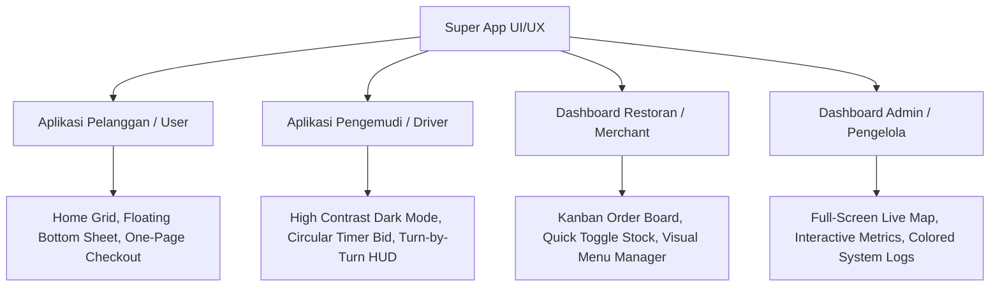

# PANDUAN REKOMENDASI DESAIN UI/UX: EKOSISTEM SUPER APP

Dokumen ini disusun sebagai panduan referensi praktis bagi desainer UI/UX untuk merancang antarmuka pengguna (user interface) dan pengalaman pengguna (user experience) pada ekosistem aplikasi **Go-Super**. Desain difokuskan pada fungsionalitas, kemudahan navigasi (*usability*), estetika premium, dan pengurangan beban kognitif pengguna.

---

## 1. PRINSIP DESAIN UTAMA (CORE DESIGN PRINCIPLES)

Untuk menyatukan berbagai layanan dalam satu aplikasi (*Super App*), desainer harus menerapkan tiga prinsip dasar berikut:

1. **Konsistensi Visual & Warna Fungsional:**
   - Gunakan warna netral (gelap/terang) sebagai latar belakang utama.
   - Gunakan warna aksen fungsional untuk membedakan jenis layanan dengan cepat:
     - **Hijau / Indigo:** Transportasi (Ride Hailing).
     - **Merah / Oranye:** Layanan Makanan (Food Delivery).
     - **Biru / Toska:** Layanan Medis/Kesehatan (Health).
     - **Kuning / Emas:** Finansial, Saldo, dan Promo.
2. **Zona Ramah Jempol (Thumb-Zone Optimization):**
   - Letakkan elemen interaktif utama seperti tombol "Pesan", "Terima Order", atau "Checkout" di 1/3 bagian bawah layar (area yang mudah dijangkau oleh jempol saat menggunakan ponsel dengan satu tangan).
3. **Desain Peta Bersih (Minimalist Map UI):**
   - Hindari visualisasi peta yang terlalu ramai. Matikan label tempat yang tidak relevan (*POI filtering*).
   - Tampilkan rute dengan warna kontras (misal: garis biru neon tebal) dengan ikon penanda (*markers*) yang memiliki bayangan (*drop shadow*) agar terlihat melayang di atas peta.

---

## 2. PANDUAN UI/UX PER PORTAL APLIKASI

### A. Aplikasi Pelanggan / User (Simulasi Mobile App)

#### 1. Halaman Beranda (Home Screen)
- **Header Finansial (e-Wallet Card):**
  - Tampilkan info saldo Go-Pay secara menonjol di bagian atas dengan tombol aksi cepat (Top Up, Bayar, Riwayat) menggunakan ikon-ikon bersih.
- **Grid Layanan Utama:**
  - Batasi menu utama maksimal dalam format grid $4 \times 2$ (8 ikon utama). Gunakan ikon bergaya 3D atau flat berwarna premium agar tidak membingungkan pengguna.
- **Rekomendasi Dinamis (Cards & Carousels):**
  - Tampilkan komedi carousel promo makanan atau rekomendasi obat berdasarkan waktu (misal: rekomendasi sarapan di pagi hari, rekomendasi obat flu di musim hujan).

#### 2. Alur Pemesanan & Pelacakan (Booking & Tracking Flow)
- **Input Lokasi Pintar:**
  - Gunakan kolom input pencarian alamat dengan fitur pencarian alamat otomatis (*autocomplete search*) dan daftar lokasi terakhir yang sering dikunjungi.
- **Bottom Sheet Interaktif (Floating Panel):**
  - Saat melacak driver, gunakan panel *bottom sheet* yang dapat ditarik ke atas (*collapsible/expandable sheet*). 
  - **Kondisi Minim (Collapsed):** Menampilkan foto driver, plat nomor kendaraan, tombol chat cepat, dan status ringkas (misal: "Driver sedang memasak makananmu").
  - **Kondisi Penuh (Expanded):** Menampilkan rincian pembayaran, rincian item belanjaan, dan tombol bantuan darurat (*SOS button*).
- **Animasi Transisi Status:**
  - Gunakan animasi transisi mikro (*micro-interactions*) pada ikon status kendaraan (misal: motor bergerak halus di atas peta sesuai dengan titik koordinat aktual).

---

### B. Aplikasi Pengemudi / Driver (Simulasi Mobile App)

#### 1. Mode Mengemudi (Online State)
- **Tombol Status Besar:**
  - Gunakan tombol geser (*swipe-to-online*) di bagian atas layar untuk menghindari ketidaksengajaan menyalakan status online.
- **Skema Warna Kontras Tinggi (Dark Mode Default):**
  - Sangat direkomendasikan menggunakan tema gelap (*dark mode*) secara default. Ini membantu menghemat baterai layar OLED ponsel driver dan mengurangi kelelahan mata saat berkendara di malam hari.

#### 2. Kartu Penawaran Order (Bid Screen Popup)
- **Desain Kartu Terapung (Floating Bid Card):**
  - Ketika ada order masuk, tampilkan kartu popup dengan latar belakang gelap kontras dan efek bayangan merah/biru berkedip lembut untuk menarik perhatian.
- **Visualisasi Timer:**
  - Tampilkan lingkaran penanda waktu (*circular countdown timer*) yang berjalan mundur (misal: 15 detik untuk menerima order) di sekeliling tombol.
- **Informasi Bersih:**
  - Tampilkan nilai **Pendapatan Bersih** driver dengan ukuran font tebal dan besar (misal: **Rp 24.000** berwarna hijau terang), serta alamat penjemputan dan pengantaran dalam format langkah vertikal yang bersih.

#### 3. Tampilan Navigasi Jalan (Turn-by-Turn Navigation)
- **Instruksi HUD (Heads-Up Display):**
  - Letakkan papan petunjuk arah (misal: "Belok Kanan 200m ke Jl. Sudirman") di bagian atas layar dengan latar belakang hijau terang (*safety green*) dan ikon panah besar.
- **Auto-Zoom Peta:**
  - Peta harus otomatis melakukan *zoom-in* saat driver mendekati belokan atau titik jemput, dan melakukan *zoom-out* saat melaju di jalan lurus yang panjang agar driver dapat melihat arah rute berikutnya secara jelas.

---

### C. Dashboard Mitra / Restoran (Merchant Food App)

#### 1. Papan Antrean Dapur (Kitchen Queue Dashboard)
- **Layout Tiga Kolom (Kanban Board):**
  - Bagilah layar menjadi tiga kolom utama yang jelas:
    1. **Pesanan Baru:** Perlu konfirmasi segera (tombol berkedip kuning).
    2. **Sedang Disiapkan:** Makanan sedang dimasak di dapur.
    3. **Siap Diantar:** Makanan sudah dikemas dan menunggu kurir mengambilnya.
- **Peringatan Suara & Visual:**
  - Setiap kali ada pesanan baru masuk, sistem harus membunyikan bel khas restoran (*notification bell loop*) dan kartu pesanan baru harus menampilkan animasi berdenyut (*pulsing card effect*).

#### 2. Manajemen Menu Cepat (Inventory Management)
- **Tombol Toggle Ketersediaan:**
  - Sediakan tombol saklar cepat (*quick switch toggle*) di samping setiap menu makanan untuk langsung menandai menu sebagai "Habis" jika bahan makanan di dapur sedang kosong.
- **Desain Input Harga Coret:**
  - Permudah merchant membuat diskon dengan kolom input harga promo yang otomatis memvisualisasikan harga lama dicoret merah dan harga baru dicetak tebal.

---

### D. Dashboard Admin (Pusat Kontrol Operasional)

#### 1. Layar Peta Pelacakan Utama (Pusat Kendali Spasial)
- **Peta Layar Penuh (Dark-Theme Map):**
  - Gunakan peta bergaya gelap (*dark map style* seperti Mapbox Dark atau CartoDB DarkMatter) agar marker kurir berwarna hijau neon atau biru terang dapat terlihat sangat menonjol.
- **Panel Sisi Terapung (Floating Side Panel):**
  - Letakkan grafik pendapatan, jumlah transaksi, dan logs sistem di panel sisi kiri/kanan yang transparan (*glassmorphism effect*), sehingga area peta di tengah tetap luas.
- **Filter Layer Peta:**
  - Sediakan tombol filter layer di pojok kanan atas untuk mematikan/menghidupkan kategori penanda (misal: "Tampilkan hanya driver yang sedang membawa makanan" atau "Sembunyikan semua apotek").

#### 2. Log Sistem & Statistik
- **Warna Identifikasi Logs:**
  - Gunakan warna tag log yang konsisten dengan tingkat keparahan:
    - **Hijau:** Sukses / Transaksi Selesai.
    - **Kuning:** Peringatan / Driver Menolak Order.
    - **Merah:** Bahaya / Percobaan Fake GPS terdeteksi.
    - **Biru:** Informasi Sistem / OSRM API terpanggil.
