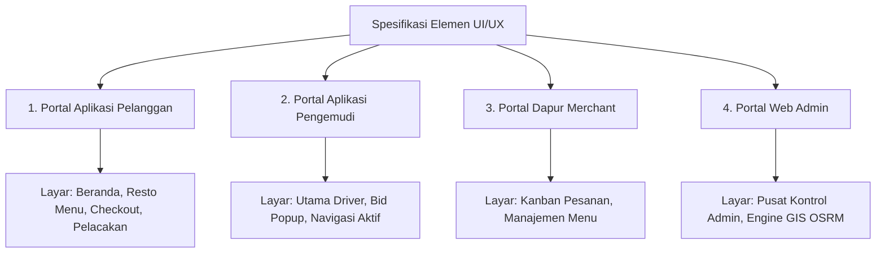

# SPESIFIKASI DETAIL ELEMEN UI/UX EKOSISTEM GO-SUPER

Dokumen ini adalah spesifikasi teknis antarmuka (*wireframe checklist*) yang menjabarkan seluruh komponen visual, kolom input, tombol aksi, dan perubahan status (*state changes*) pada setiap layar di 4 portal utama ekosistem **Go-Super**. 

Dokumen ini dirancang agar desainer UI/UX dapat langsung membuat *wireframe* (Lo-Fi) maupun *mockup* interaktif (Hi-Fi) tanpa ada komponen yang terlewat.

---

## DAFTAR MODUL & SPESIFIKASI LAYAR

---

## 1. PORTAL APLIKASI PELANGGAN (USER APP) - MOBILE VIEW

### Layar 1: Beranda Utama (Home Screen)
Tujuan: Pusat navigasi layanan, informasi keuangan cepat, dan promosi.
*   **Header Area (Status Bar & Profil):**
    *   [ ] Ikon Avatar Profil Pengguna (pojok kiri atas).
    *   [ ] Label Teks Sapaan: `"Halo, Davy Pratama"` (font medium, 14px).
    *   [ ] Ikon Lonceng Notifikasi (pojok kanan atas) dengan indikator titik merah (*badge*) jika ada pesan belum terbaca.
*   **Kartu e-Wallet (Go-Pay Card):**
    *   [ ] Desain kartu dengan warna latar belakang Indigo/Kuning Gradasi.
    *   [ ] Logo `"Go-Pay"` (putih, kiri atas kartu).
    *   [ ] Angka Saldo: `"Rp 150.000"` (font bold, 22px).
    *   [ ] Grid Tombol Aksi Finansial (4 Tombol):
        *   [ ] Tombol `Top Up` (Ikon Tanda Plus + Teks).
        *   [ ] Tombol `Bayar` (Ikon QR Code Scan + Teks).
        *   [ ] Tombol `Transfer` (Ikon Panah Kanan + Teks).
        *   [ ] Tombol `Riwayat` (Ikon Jam/Kertas Transaksi + Teks).
*   **Grid Menu Layanan Utama ($4 \times 2$ Grid):**
    *   [ ] Tombol Layanan `Go-Ride` (Ikon Motor warna Hijau).
    *   [ ] Tombol Layanan `Go-Food` (Ikon Garpu & Sendok warna Merah).
    *   [ ] Tombol Layanan `Go-Health` (Ikon Kapsul/Salib Medis warna Biru).
    *   [ ] Tombol Layanan `Go-Send` (Ikon Paket warna Biru Muda).
    *   [ ] Tombol Layanan `Go-Mart` (Ikon Keranjang Belanja warna Oranye).
    *   [ ] Tombol Layanan `Go-Pulsa` (Ikon Handphone/Petir warna Kuning).
    *   [ ] Tombol Layanan `Go-Club` (Ikon Bintang/Loyalty warna Ungu).
    *   [ ] Tombol Layanan `Lainnya` (Ikon Tiga Titik warna Abu-abu).
*   **Promo Carousel & Banner:**
    *   [ ] Paging Indicator (titik-titik kecil penanda slide aktif).
    *   [ ] Banner Gambar Promo (Rasio aspek 16:9, sudut melengkung/border-radius 12px).
*   **Bottom Navigation Bar (Fixed di bagian paling bawah):**
    *   [ ] Tombol `Beranda` (Aktif - Ikon Rumah).
    *   [ ] Tombol `Pesanan` (Ikon Riwayat Order).
    *   [ ] Tombol `Chat` (Ikon Gelembung Percakapan).
    *   [ ] Tombol `Akun` (Ikon Pengguna).

### Layar 2: Detail Restoran & Menu (Mitra Go-Food View)
Tujuan: Memilih makanan dari merchant kuliner pilihan.
*   **Header Informasi Restoran:**
    *   [ ] Tombol `Kembali` (Panah kiri).
    *   [ ] Foto Banner Restoran (misal: "Bakso Solo Baru") sebagai latar belakang header.
    *   [ ] Nama Restoran: `"Bakso Solo Baru - Sudirman"` (font bold, 18px).
    *   [ ] Tag Kategori: `"Makanan Indonesia • Bakso • Halal"`.
    *   [ ] Informasi Rating & Jarak: `⭐ 4.8 (100+ Rating) • 1.2 KM`.
*   **Katalog Daftar Menu (Vertical List):**
    *   [ ] Tab Kategori Menu Horizontal: `[Populer] [Paket Kenyang] [Minuman] [Cemilan]`.
    *   [ ] Kartu Item Menu (Setiap Item Makanan):
        *   [ ] Foto Makanan (Kotak, 80x80px, border-radius 8px).
        *   [ ] Nama Menu: `"Bakso Istimewa Urat Besar"` (font semi-bold, 14px).
        *   [ ] Deskripsi Menu: `"Bakso urat jumbo, tahu bakso, mie kuning, bihun, kuah kaldu sapi hangat."`.
        *   [ ] Teks Harga: `"Rp 22.000"` (font bold, 14px, warna putih/hijau).
        *   [ ] Tombol `+ Tambah` (Warna hijau, pojok kanan bawah kartu menu). Jika diklik berubah menjadi pemilih kuantitas `[ - ]  1  [ + ]`.
*   **Floating Cart Bar (Hanya muncul jika minimal 1 item dipilih):**
    *   [ ] Label Teks Ringkasan: `"1 Item | Rp 22.000"` (kiri).
    *   [ ] Tombol Aksi: `"Lihat Keranjang 🛒"` (kanan, mengarahkan ke Checkout).

### Layar 3: Konfirmasi Pemesanan & Pembayaran (Checkout Screen)
Tujuan: Memverifikasi rincian pesanan, rute, tarif, dan menempatkan pesanan.
*   **Peta Rute Mini (Map Preview):**
    *   [ ] Container Peta Map (Tinggi minimal 180px).
    *   [ ] Marker Hijau 🟢 (Titik Jemput/Merchant) & Marker Merah 📍 (Tujuan Antar).
    *   [ ] Garis Rute (Polyline berwarna biru neon/indigo).
*   **Detail Alamat Pengiriman:**
    *   [ ] Label Teks: `"Lokasi Pengantaran"` (font bold, 12px, abu-abu).
    *   [ ] Nama Lokasi/Gedung: `"Sudirman Center Lantai 5"` (font bold, 14px).
    *   [ ] Catatan untuk Kurir: `"Titip di resepsionis depan lift."`.
*   **Rincian Biaya (Billing Summary):**
    *   [ ] Baris 1: `Harga Makanan (x1): Rp 22.000`.
    *   [ ] Baris 2: `Ongkos Kirim (2.5 KM): Rp 8.000`.
    *   [ ] Baris 3: `Biaya Layanan Aplikasi: Rp 2.000`.
    *   [ ] Garis Pembatas Tipis (*Divider*).
    *   [ ] Baris 4: **Total Pembayaran: Rp 32.000** (font bold, 16px).
*   **Metode Pembayaran (Payment Selector):**
    *   [ ] Baris Pilihan: `[Ikon Go-Pay] Go-Pay (Saldo: Rp 150.000)` (Pilihan Aktif).
    *   [ ] Ikon Panah Kanan `>` untuk mengganti metode (Cash/PayLater).
*   **Tombol Utama (CTA):**
    *   [ ] Tombol Besar Lebar Penuh: `"PESAN & ANTAR SEKARANG"` (Warna Hijau untuk Ride, Merah untuk Food, lebar penuh, tinggi 48px).

### Layar 4: Pelacakan Pesanan Realtime (Order Tracking Screen)
Tujuan: Memantau pergerakan pengemudi secara langsung.
*   **Layar Peta Interaktif Layar Penuh (Full-screen Map):**
    *   [ ] Marker Driver bergerak secara berkala.
*   **Floating Bottom Sheet (Collapsed State - Tampilan Default):**
    *   [ ] Bar Status Animasi: Teks `"Driver Sedang Menuju Lokasimu 🛵"` dengan badge warna kuning berkedip.
    *   [ ] Info Driver: Foto driver Budi Santoso (lingkaran), Nama, Plat Nomor `"B 1234 ABC"`, rating driver `⭐ 4.9`.
    *   [ ] Baris Komunikasi:
        *   [ ] Kolom Chat cepat: `"Kirim pesan ke driver..."` (kolom input teks).
        *   [ ] Tombol Ikon Telepon (warna biru).
*   **Floating Bottom Sheet (Expanded State - Saat ditarik ke atas):**
    *   [ ] Teks Rincian Pesanan Lengkap (Daftar makanan yang dibeli).
    *   [ ] Detail transaksi bagi hasil finansial yang terpotong.
    *   [ ] Tombol `Bantuan / SOS` (Merah, untuk melaporkan kendala perjalanan).

---

## 2. PORTAL APLIKASI PENGEMUDI (DRIVER APP) - MOBILE VIEW

### Layar 1: Dasbor Utama Driver (Driver Home)
Tujuan: Mengatur status ketersediaan kerja dan memantau pendapatan hari ini.
*   **Header Status Kerja:**
    *   [ ] Tombol Toggle Geser Lebar: `"GESER UNTUK ONLINE"` (Warna abu-abu jika offline, berubah menjadi Hijau `"ONLINE - MENCARI ORDER"` jika digeser).
*   **Kartu Dompet Finansial (Driver Wallet Card):**
    *   [ ] Judul: `"Pendapatan Bersih Hari Ini"` (font kecil, abu-abu).
    *   [ ] Nilai Saldo: `"Rp 120.000"` (font bold, 24px, putih).
    *   [ ] Sub-Teks Status: `"5 Perjalanan Selesai"` (warna hijau).
*   **Pusat Status Berkas & Dokumen:**
    *   [ ] Judul Panel: `"Verifikasi Akun Mitra Driver"`.
    *   [ ] Daftar Ceklist Berkas (Berwarna Hijau jika Terverifikasi):
        *   [ ] `[✓] Foto KTP Asli`
        *   [ ] `[✓] Surat Izin Mengemudi (SIM C)`
        *   [ ] `[✓] STNK Kendaraan Aktif`
        *   [ ] `[✓] Foto Profil Pengemudi`

### Layar 2: Kartu Popup Penawaran Order (Order Bid Card Popup)
Tujuan: Menerima atau menolak tawaran pekerjaan baru.
*   **Efek Layar Terapung:** Latar belakang di-blur penuh, kartu order melayang di tengah layar.
*   **Header Kartu:**
    *   [ ] Tag Label Jenis Layanan: `[FOOD DELIVERY]` (badge merah cerah) atau `[RIDE HAILING]` (badge biru).
    *   [ ] Lingkaran Detik Mundur (*Circular Timer Ring*): Teks hitung mundur tengah `15` detik.
*   **Ringkasan Perjalanan Spasial (Route Summary):**
    *   [ ] Baris Arah Vertikal:
        *   [ ] Titik Hijau 🟢: `"Ambil: Restoran Ayam Geprek Gahar, Sudirman"`.
        *   [ ] Titik Merah 📍: `"Antar: Sudirman Center (Davy Pratama)"`.
    *   [ ] Informasi Jarak Tempuh: `"Jarak Pengantaran: 2.5 KM"`.
*   **Informasi Pembayaran Bersih:**
    *   [ ] Label: `"Pendapatan Bersih Anda (80%):"`
    *   [ ] Nominal: `"Rp 8.000"` (Font ukuran 24px, bold, warna hijau terang).
*   **Tombol Aksi Bawah:**
    *   [ ] Tombol Kiri: `"TOLAK"` (Merah/Abu-abu gelap, lebar 40%).
    *   [ ] Tombol Kanan: `"TERIMA ORDER"` (Hijau Cerah, lebar 55%).

### Layar 3: Peta Navigasi Perjalanan Aktif (In-Trip Navigation)
Tujuan: Memandu driver di jalan menuju penjemputan dan pengantaran.
*   **Papan Petunjuk Arah (Top HUD):**
    *   [ ] Latar belakang hijau jalan tol (*Safety Green*).
    *   [ ] Ikon Arah: Ikon panah belok kiri/kanan/lurus berukuran besar.
    *   [ ] Teks Panduan: `"Belok kanan 150m menuju Jl. Sudirman"`.
*   **Peta Navigasi Interaktif:** Peta Leaflet dengan marker pengemudi yang berada di tengah rute jalan.
*   **Panel Informasi Pelanggan (Tray Bawah):**
    *   [ ] Nama Konsumen: `"Davy Pratama"` • Pembayaran: `[Go-Pay]`.
    *   [ ] Tombol aksi cepat: `[Ikon Chat]` untuk membuka jendela chat instan dengan pelanggan.
    *   [ ] Tombol Aksi Utama (Lebar penuh di bawah):
        *   [ ] Tahap 1: `"SAYA SUDAH TIBA DI LOKASI JEMPUT"` (Warna Biru).
        *   [ ] Tahap 2: `"MULAI PERJALANAN (KONSUMEN SUDAH NAIK)"` (Warna Indigo).
        *   [ ] Tahap 3 (Disabled saat bergerak, Enabled saat sampai): `"SELESAIKAN PERJALANAN & TERIMA DANA"` (Warna Hijau).

---

## 3. PORTAL DAPUR MERCHANT (MERCHANT APP) - TABLET/DESKTOP VIEW

### Layar 1: Dasbor Manajemen Antrean Dapur (Order Queue Board)
Tujuan: Memproses pesanan dapur dan berinteraksi dengan driver pengirim.
*   **Papan Kanban 3 Kolom Utama:**
    1.  **Kolom 1: Pesanan Masuk (Order Inflow)**
        *   [ ] Kartu pesanan berwarna kuning berkedip (*pulsing card*).
        *   [ ] Detail Item: `"Ayam Geprek Level 3 (x1) • Ekstra Keju (x1)"`.
        *   [ ] Tombol Aksi: `"Terima & Siapkan Pesanan 👨‍🍳"` (Warna hijau).
    2.  **Kolom 2: Sedang Dimasak (Cooking In-Progress)**
        *   [ ] Kartu pesanan berwarna putih dengan progress bar berputar.
        *   [ ] Teks status: `"Dapur sedang menyiapkan menu..."`.
        *   [ ] Tombol Aksi: `"Tandai Selesai (Siap Diantar) 📦"` (Warna biru).
    3.  **Kolom 3: Menunggu Kurir / Diambil (Ready for Pickup)**
        *   [ ] Kartu pesanan berwarna hijau stabil.
        *   [ ] Info Driver Penjemput: `"Kurir Budi Santoso sedang menuju resto (ETA 3 menit)"`.
        *   [ ] Teks status: `"Menunggu makanan diserahkan ke kurir."`.

### Layar 2: Pengaturan Katalog Menu & Stok Restoran
Tujuan: Menambah, menghapus, atau menonaktifkan menu makanan secara instan.
*   **Tabel Katalog Menu:**
    *   [ ] Daftar kolom: `[Foto Produk] [Nama Menu] [Harga Jual] [Harga Coret/Promo] [Status Stok] [Aksi]`.
    *   [ ] Tombol saklar toggle cepat `[ Aktif / Habis ]` di setiap baris menu.
    *   [ ] Kolom Edit Harga Promo untuk memasukkan diskon langsung yang terintegrasi ke aplikasi user.

---

## 4. PORTAL WEB ADMIN DASHBOARD (ADMIN PANEL) - DESKTOP VIEW

### Layar 1: Pusat Pemantauan Operasional (Main Console)
Tujuan: Layar utama pengawasan sistem, keuangan, serta mitigasi kecurangan kurir.
*   **Peta Pemantauan Realtime Layar Penuh (Live Tracking Map):**
    *   [ ] Desain peta gelap (*dark mode*) menggunakan Leaflet.
    *   [ ] Penanda berwarna khusus:
        *   [ ] `🟢 Marker Hijau`: Driver Online Siaga.
        *   [ ] `🛵 Marker Motor`: Driver Sedang Membawa Pesanan (Bergerak).
        *   [ ] `🏪 Marker Toko`: Restoran/Merchant Mitra Aktif.
*   **Panel Sisi Statistik Utama (Floating Stats Panel):**
    *   [ ] Angka Total Pendapatan Platform: `"Rp 480.000"` (font bold, 20px).
    *   [ ] Angka Driver Online: `"12 Driver Aktif"`.
    *   [ ] Angka Order Sukses Hari Ini: `"45 Transaksi"`.
*   **System Event Logs Terminal (Logs Activity Console):**
    *   [ ] Tampilan kotak teks konsol berlatar belakang hitam dengan font monospace hijau/putih.
    *   [ ] Pemilah log berwarna berdasarkan level peringatan:
        *   [ ] `[INFO]` berwarna biru: `"Request OSRM API rute Sudirman-Monas berhasil."`.
        *   [ ] `[SUCCESS]` berwarna hijau: `"Pembayaran Go-Pay order #FD-998 sukses."`.
        *   [ ] `[WARNING]` berwarna kuning: `"Driver Budi menolak order. Sistem mengalihkan ke driver Anto."`.
        *   [ ] `[SUSPENDED]` berwarna merah: `"Fake GPS Terdeteksi! Akun driver Budi ditangguhkan sementara."`.
*   **Form Konfigurasi Tarif Layanan:**
    *   [ ] Kolom Input: `Tarif Per KM (Rupiah)` -> Default `Rp 2.500`.
    *   [ ] Kolom Input: `Tarif Minimum Perjalanan` -> Default `Rp 8.000`.
    *   [ ] Kolom Input: `Biaya Layanan Aplikasi` -> Default `Rp 2.000`.
    *   [ ] Kolom Input: `Komisi Potongan Platform (%)` -> Default `20%`.
    *   [ ] Tombol: `"Simpan Konfigurasi & Terapkan Live"`.

### Layar 2: Dashboard OSRM GIS Routing Engine (Engine Setup View)
Tujuan: Monitoring performa routing peta, pengaturan script LUA, dan simulasi compiler Docker.
*   **Editor Profil LUA (Syntax Highlighted Code Block):**
    *   [ ] Tab seleksi profil: `[motorcycle.lua]` dan `[car.lua]`.
    *   [ ] Script LUA editor untuk mengubah kecepatan kendaraan dan pembatasan gang sempit.
*   **Simulator Compiler Peta (Docker Build Terminal):**
    *   [ ] Tombol: `"JALANKAN PIPELINE KOMPILASI PETA (.OSM.PBF)"`.
    *   [ ] Bar Kemajuan (*Progress Bar*) pengolahan data peta.
    *   [ ] Terminal log output langkah: `osrm-extract` -> `osrm-partition` -> `osrm-customize`.
*   **Gauge Monitor Beban RAM Server:**
    *   [ ] Lingkaran indicator beban memori (*RAM usage gauge*) yang meningkat dinamis saat proses kompilasi peta berjalan.
